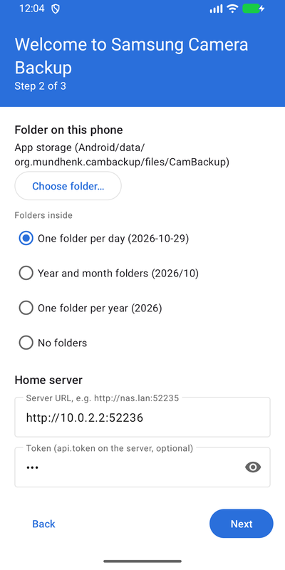
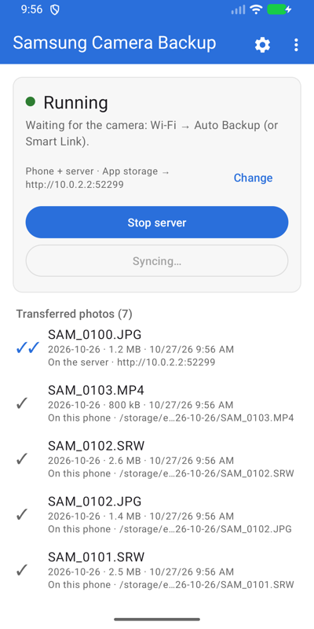
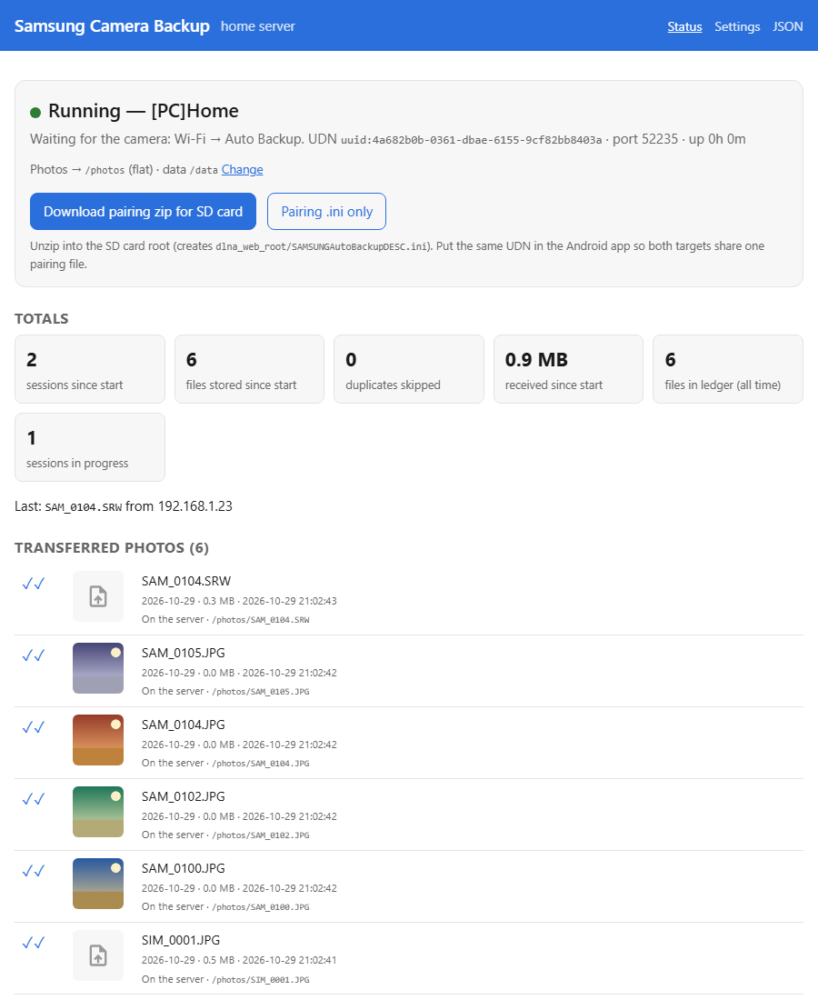

My NX1000 is a mirrorless camera from 2012 with a feature that was ahead of its time: Wi-Fi, and with it *Auto Backup*.
Turn the mode dial, press a button, and every new photo walks over to a PC in the house.
The camera still does that today, but the other end is gone.
Samsung left the camera business, the Windows tool no longer installs, and the cloud services are switched off.
So I wrote the other end myself.
[Samsung Camera Backup](https://github.com/PhilippMundhenk/SamsungCameraServer) has two halves.
An Android app makes the phone the camera's backup target on the road.
A small home server in a container does the same at home and processes the files afterwards.
This post shows what the two halves do, how fast the camera really is, and what a 2012 firmware teaches about testing.

## Two halves, one identity

The camera learns about its backup target from a small text file on the SD card.
Both halves of this project write that file and can present the same identity to the camera.
So one card works at home and on the road, with whichever target the camera finds on its network.
The project's [protocol notes](https://github.com/PhilippMundhenk/SamsungCameraServer/blob/main/docs/PROTOCOL.md) explain how the camera finds the target and what it sends.
For this post it is enough to know that the camera is a plain network client.
It keeps its own record of what it has already sent and never offers a file twice.

That last point shaped the design more than anything else.
A photo delivered to the phone on a trip is never offered to the home server, so the phone has to hand it on.

## The app

The app comes as an APK from the [releases page](https://github.com/PhilippMundhenk/SamsungCameraServer/releases).
It runs a foreground service that waits for the camera, either on the phone's hotspot or on a shared Wi-Fi.
On first start, a three-step wizard asks where photos should go, which folder or server to use, and what name the camera should show.
At the end it exports the pairing file for the SD card.



There are three modes.
*Phone only* keeps the files in a folder on the phone, for example one that a sync client watches.
*Home server only* streams every file straight to the server and keeps nothing.
*Phone + home server* is the one I use when travelling, because it keeps the files on the phone and hands them on to the server by itself.
It does so in the background whenever the server is reachable, until everything has arrived.

The main screen lists every transferred file with a mark borrowed from messengers.
One check means the file is on the phone, two mean it has reached the home server.
Photos get a small preview, and a tap opens the file in the gallery.
Next to *Start server* sits a *Hotspot* button that takes you to the system switch, since Android lets no app turn the hotspot on itself.



Settings live on their own screen and are locked while the server runs.
Changing the identity is the one dangerous action in the app, because every card paired with the old identity stops working.
So the app asks first and keeps a history of previous identities to switch back to.

## The home server

The server is one container with one port.
It is the always-on target on the LAN, the backend the app uploads to, and the place where files get processed:

- Shift all EXIF dates with exiftool. Cameras of this age know nothing about daylight saving time.
- Render a JPEG next to every RAW file. The image ships RawTherapee for that, with LibRaw's `dcraw_emu` as a fallback.
- Rename files from their EXIF date and camera model, with a pattern.
- Move finished files into an export folder. In my case that is the share [photosort](https://github.com/PhilippMundhenk/photosort) watches.
- Call a webhook or a shell command after every session. That is how Home Assistant learns about it.

Every stage is optional and is skipped with a log line when its tool is missing.
Every setting can also be overridden per camera, so a second camera with a differently wrong clock gets its own time shift.
A ledger remembers every file ever received, which catches duplicates even after a file has been renamed and moved away.
An upload that breaks off, for example when the Wi-Fi drops, is kept for the camera to pick up in its next session.

The status page shows totals, the recent files with previews, the devices and the log.
Cameras are told apart by their address, and the page lets you give them a name.
It also hands out the pairing file as a zip, and every setting can be changed on a settings page next to it.



One server can serve a whole household.
Every user gets an identity, a pairing file and a folder of their own, so nobody's holiday ends up in somebody else's album.

Deployment is a compose file with two volumes.
The small `/data` holds configuration, identity and ledger, while `/photos` holds the files themselves.

```yaml
services:
  cambackup:
    image: ghcr.io/philippmundhenk/cambackup-server:latest
    network_mode: host          # the camera finds the server by multicast
    restart: unless-stopped
    volumes:
      - ./data:/data
      - ./photos:/photos
    environment:
      CAMBACKUP_SERVER_NAME: "[PC]Home"
      CAMBACKUP_API_TOKEN: change-me
```

`latest` follows the newest release, and every release also has its own version tag.
Host networking lets the camera's discovery packets reach the container, and a macvlan network on the camera's VLAN works as well.
Every option is in [docs/SERVER.md](https://github.com/PhilippMundhenk/SamsungCameraServer/blob/main/docs/SERVER.md).

## Speed and limits

The camera's 2012 Wi-Fi sets the pace, not the server.
Each file moves at a steady 0.65 MB/s, small JPEG or forty-megabyte video alike.
A whole run comes out a little slower, because every file costs a round trip and a new connection.
A full session of 1,000 files and 3.8 GB takes one hour and 52 minutes, or 0.57 MB/s end to end.
So plan with 4.5 to 5 Mbit/s, which means a few seconds per photo and a minute per video.
It pays to back up after every outing rather than after a season.

The camera also sends at most a thousand files per run, newest first, and remembers what it sent.
A card with more new files simply needs Auto Backup started again.
Both targets log the rate per file, so nobody has to wonder.

## What the real camera taught me

The simulator is built from protocol notes, and the real camera follows them almost everywhere.
The exception is a session after an interrupted one.
Before it uploads anything, the camera asks about the file it was sending when the last run ended.
It accepts exactly two answers: "here is that file" or "there is no such file".
Anything else leaves it waiting on its transfer screen for good.
Both halves answer that question properly, and the simulator asks it on every test run.

Two lessons from that.
A simulator only knows the sessions you have seen, so the real device belongs in the test plan for every kind of session.
And it pays to log every request, not just the interesting ones.
The camera's question was in the log long before anyone looked for it.

There is a pleasant consequence, too: phone and home server need no synchronisation between them.
The camera keeps the only state that matters, per file, on its card.
The [protocol notes](https://github.com/PhilippMundhenk/SamsungCameraServer/blob/main/docs/PROTOCOL.md) have the details.

## Testing without a camera

The camera sat in a drawer for most of the development, so the test setup had to stand in for it.
A camera simulator runs a complete session against any target it is pointed at, and it is used everywhere.
The JVM tests of the protocol core use it, and so do the server tests.
The Espresso tests run it against the app on an Android emulator.
The server image even ships it as a command, to test a deployment from any machine on the network.

Every module has a coverage gate at 95 percent of lines.
A smoke test builds the real container image and pushes a JPEG through the whole pipeline.
The Espresso suite drives the real app against a fake home server, on an emulator in GitHub Actions on every push.

That setup caught several bugs I would otherwise have found the slow way.
They included a truncated upload that was accepted as complete and a container that could not move files between two volumes.
The one thing it could not know in advance was the camera's question about an interrupted file, which the simulator now asks as well.

## How it was built

I should be honest about the amount of work here, which is far more than my evenings would have covered.
Most of the project was written together with Claude Code, over a few days while I was traveling.
I would not have written the tests, the simulator, the CI pipeline and the documentation by hand.
I tested the camera myself, though, because no simulator knows what a 2012 firmware will do until it does it.

Samsung Camera Backup is an independent project with no relation to Samsung, and the name only says which cameras it is for.

## Improvements

One thing I would still like to do:

- **The Play Store**: Google only admits a new app after a closed test with at least 12 testers who keep it installed for 14 days. For an app this specific, finding them is the hard part. If you own one of these cameras and an Android phone, [#26](https://github.com/PhilippMundhenk/SamsungCameraServer/issues/26) explains how to help.

As always, the code is on [GitHub](https://github.com/PhilippMundhenk/SamsungCameraServer), and improvements are welcome.

## References

- [Samsung Camera Backup](https://github.com/PhilippMundhenk/SamsungCameraServer): App, server, docs
- [ge0rg/samsung-nx-hacks](https://github.com/ge0rg/samsung-nx-hacks) and [n-i-x/pc-autobackup](https://github.com/n-i-x/pc-autobackup): The earlier work this builds on
- [photosort](https://github.com/PhilippMundhenk/photosort): Where the files go next
