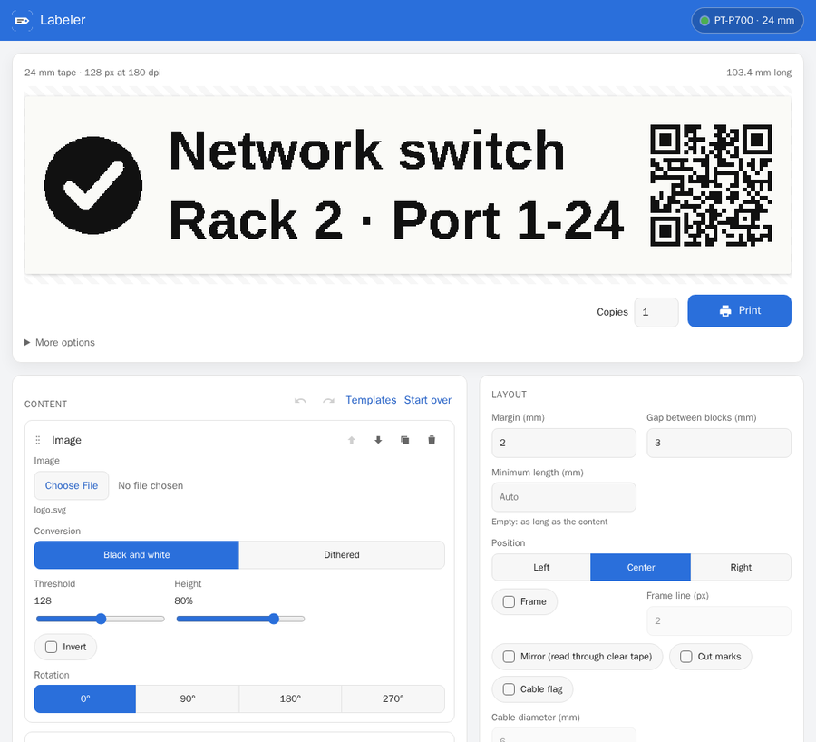
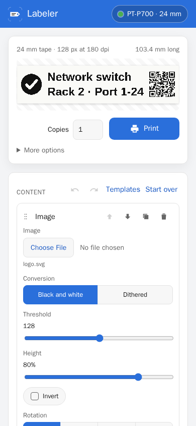
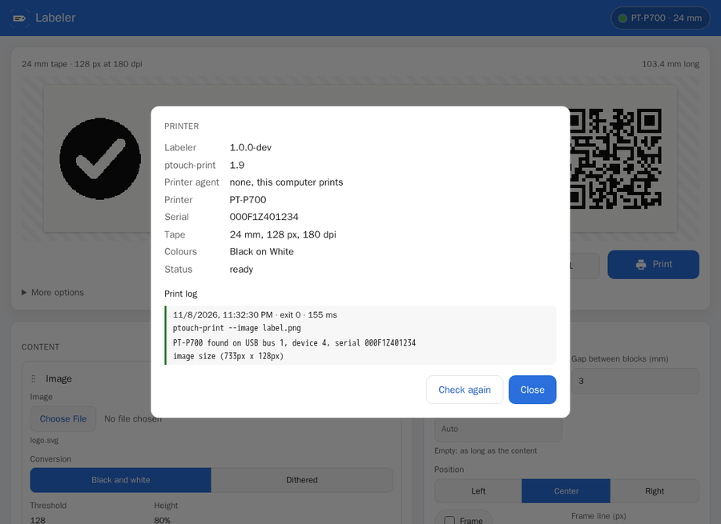

A few years ago I wrote [Labeler](/labeler/), a small web page to print on a Brother P-Touch label printer from my phone.
It was one PHP file with a form, and it did exactly two things: One line of text, or two.
Then ptouch-print, the tool underneath, got a new command line parser, and the preview and two-line labels stopped working.
Looking closer, I also found that the page handed the label text straight to a shell, which is about the worst thing a web form can do.
So the old page was not worth fixing, and I rebuilt [Labeler](https://github.com/PhilippMundhenk/labeler) from scratch.
This post is the tour: What it does now, why it draws in the browser, and how to test a label printer without one.



## Background

The printing itself is done by [ptouch-print](https://git.familie-radermacher.ch/linux/ptouch-print.git) by [Dominic Radermacher](https://dominic.familie-radermacher.ch/).
It is a command line tool that talks to P-Touch printers over USB, and Brother offers nothing comparable for Linux.
The original Labeler built a ptouch-print command from the form fields, ran it, and showed the preview image ptouch-print wrote to disk.

Two things went wrong with that.
With version 1.7, ptouch-print moved to a new argument parser that no longer accepts positional arguments.
A second line of text used to be one, so two-line labels failed with "No arguments supported".
The preview broke for a similar reason.
The second problem was older and entirely mine: The label text went into a shell command unescaped.
Anyone who could open the page could run commands on the Pi, with a label as a side effect.

## Drawing in the browser

The rebuild turns the old approach around.
The label is no longer composed by ptouch-print from text arguments.
Instead, the browser draws the whole label on a canvas, at the printer's resolution and in the height of the inserted tape.
It then converts the canvas into a black-and-white PNG with one bit per pixel and sends it to the server.
The server checks the image against the tape and calls `ptouch-print --image` with it, and that is all ptouch-print has to do.

This has a few pleasant consequences.
The preview is the printout, pixel for pixel, and it updates while typing.
The Pi only passes an image on, which matters on a Raspberry Pi Zero that would otherwise render fonts and QR codes itself.
And the one option Labeler relies on, `--image`, exists in every ptouch-print since 1.5, so the same Labeler works with versions 1.5 to 1.9.
Newer options, like copies, chain printing or several printers on one computer, are switched on only when `--version` says they are there.

The shell is gone as well.
ptouch-print now runs with a list of arguments that never passes through a shell, and nothing a user types ends up in a command line.

## What it does now

With the browser doing the drawing, features became cheap, and I added more than I originally planned.
A label is made of blocks side by side: Text, icon, QR code, barcode, image or empty space.
Text can have several lines in any font, with a size per line, bold, italic and white on black.
Icons come from [Material Design Icons](https://pictogrammers.com/library/mdi/) and [Simple Icons](https://simpleicons.org/), searched and loaded through the [Iconify](https://iconify.design/) API.
The QR code block has helpers for Wi-Fi access, contacts, e-mail and phone numbers, so the guest Wi-Fi label is a template rather than an exercise in escaping.
Barcodes cover Code 128, EAN-13, UPC-A and Code 39.

Blocks can be rotated for folder spines and shelf edges.
A cable flag prints the content twice with the cable's circumference in between, so both sides read upright once it is wrapped around a cable.
Placeholders such as `{date}` and a counter `{n}` give every copy its own value.
Batch printing takes a pasted list or a CSV file and prints one label per row, which is how I would label a box of identical chargers.
There are templates to start from, undo and redo, a list of recent prints, and labels saved in the browser or on the server.



The interface speaks the 15 most spoken languages, from Chinese and Hindi to Arabic, which reads right to left.
English is the original, all other languages were translated by machine and wait for native speakers to correct them.
It also has a dark mode, works on a phone and can be put on the home screen.
An optional password keeps the rest of the network from printing, if that is a concern in your house.

## Pi Zero or printer agent

Labeler is still made for a Raspberry Pi Zero next to the printer.
That rules out a lot: No Docker on the device, no database, no build step, and nothing beyond PHP's standard library.
It runs on PHP's built-in web server under systemd, and the pages are plain HTML and JavaScript modules.

The other option is to run the interface in Docker on a server and leave only a small printer agent next to the printer.
The agent is Labeler's API without the interface, protected by an access token it generates on installation.
The interface forwards status requests and print jobs to it.

Both are installed with one command, which also updates an existing installation when run again and can remove it with `--uninstall`:

```sh
curl -fsSL https://raw.githubusercontent.com/PhilippMundhenk/labeler/main/deploy/install.sh | sudo sh -s -- --agent
```

Without `--agent` it installs the full interface.
The slow part on a Pi Zero used to be ptouch-print itself.
Building it from source needs a compiler and about 100 packages, and the compilation takes a long time on a single ARMv6 core.
Labeler now publishes ready-made static builds of ptouch-print instead, linked against musl.
Each is one file of about 0.5 MB without library dependencies, and the ARMv6 build runs on every Raspberry Pi.
Since ptouch-print is under the GPL-3.0, the builds come with their license and the exact sources they were made from.

## Testing a printer without a printer

Most of the development happened without a printer attached, so the tests had to stand in for one.
There are three layers.

The first is a simulator of ptouch-print, written in PHP.
It answers like versions 1.5 to 1.9 do, including their quirks and error messages.
It can also pretend to be a printer with a jammed cutter, an open cover or no tape.
The server tests and the browser tests run against it.

The second layer keeps the simulator honest.
A contract test in CI builds the real ptouch-print 1.6 to 1.9 from its sources and checks the assumptions the simulator makes against them.
A weekly job does the same with ptouch-print's main branch, so a change upstream shows up before a user finds it.
Underneath the real ptouch-print sits a fake libusb that records every byte sent to the "printer", so even the raster data can be compared.

The third layer is the browser.
[Playwright](https://playwright.dev/) drives the real interface, prints labels, and decodes the printed QR codes and barcodes with zxing to check they say what was typed.
[axe](https://github.com/dequelabs/axe-core) checks every screen for accessibility problems in light and dark mode.
Every file has to keep 95 percent line coverage, or the build fails.



## The printer can do more than it is told

Brother publishes a raster command reference for these printers (for example for the [PT-E550W, P750W and P710BT](https://download.brother.com/welcome/docp100064/cv_pte550wp750wp710bt_eng_raster_102.pdf) and the [PT-P900 series](https://download.brother.com/welcome/docp100407/cv_ptp900_eng_raster_102.pdf)), and it contains a few things ptouch-print does not use.
A half cut cuts the tape but not its backing, so a strip of labels stays in one piece.
The margin before and after a label can be reduced, which wastes less tape.
The printer can cut only after every n labels, and some models print at twice the resolution along the tape.

These are implemented as six small patches for ptouch-print, four of them for the new options.
Each patch adds one feature and is written so it could go upstream unchanged.
Without the new options, the patched ptouch-print sends exactly the same bytes as the original, and the fake libusb checks that byte for byte.
With them, it checks that the commands match the reference.
In Labeler, the options appear under *More options* and stay greyed out with an unpatched ptouch-print.

## How it was built

Labeler was rebuilt together with Claude Code.
Every change started as a GitHub issue and went in as its own pull request, merged only once CI was green.
I would not have written the simulator, the contract tests or the fake libusb by hand for a label printer.
They are, however, the reason I trust a change that I have not printed yet.
I did test the result on a real printer, though.
One setup had the agent on a Raspberry Pi and the interface in Docker, the other was a full installation on a Pi Zero.
Both printed a label with a QR code, an icon and two lines of text.

Labeler is an independent project with no relation to Brother Industries, and the name P-Touch only says which printers it works with.

## Improvements

- **Patches on real hardware**: The half cut, margin, cut and resolution options are checked against Brother's reference and a fake printer, but not yet on a real one.
- **Upstream**: The patches are ready to be integrated into ptouch-print upstream.

As always, the code is on [GitHub](https://github.com/PhilippMundhenk/labeler), and improvements are welcome.

## References

- [Labeler](https://github.com/PhilippMundhenk/labeler): The interface, agent and installer
- [ptouch-print](https://git.familie-radermacher.ch/linux/ptouch-print.git): The tool that talks to the printer
- [Labeler patches for ptouch-print](https://github.com/PhilippMundhenk/labeler/blob/main/docs/PTOUCH-PRINT.md): Half cut, margin, cut and resolution
- [Brother Raster Command Reference, PT-E550W/P750W/P710BT](https://download.brother.com/welcome/docp100064/cv_pte550wp750wp710bt_eng_raster_102.pdf): The commands the printers understand
- [Brother Raster Command Reference, PT-P900 series](https://download.brother.com/welcome/docp100407/cv_ptp900_eng_raster_102.pdf): The same for the 360 dpi printers
- [ptouch-print fork](https://github.com/PhilippMundhenk/ptouch-print): The patches, one commit each
- [Labeler](/labeler/): The original post from 2022
- [Iconify](https://iconify.design/): Where the icons come from
