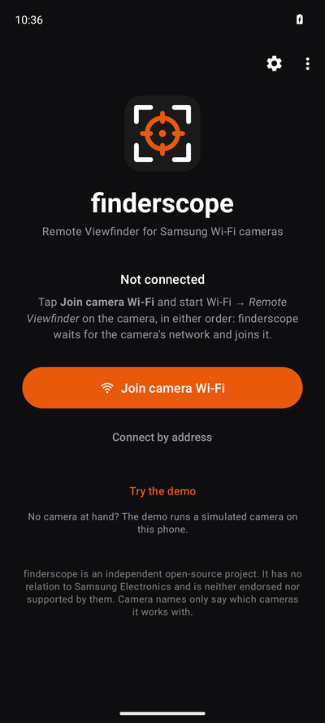
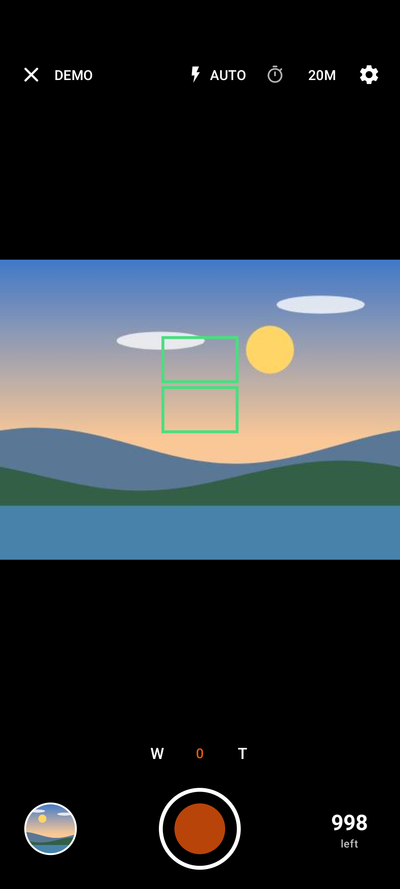
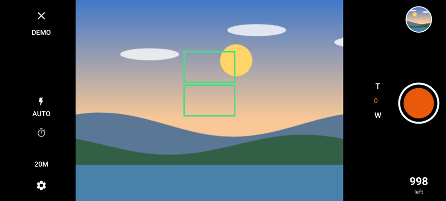
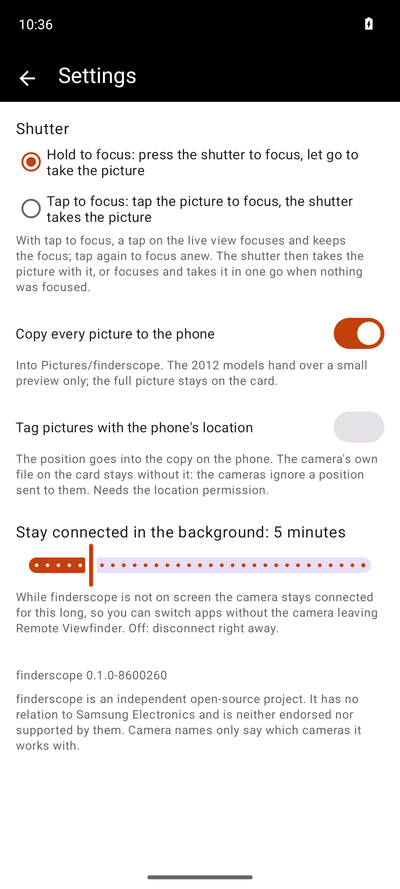

My NX1000 has a second Wi-Fi trick besides the [Auto Backup I wrote a server for](/samsung-camera-backup/).
It can show its live view on a phone and take the picture from there.
That is handy for a tripod shot or a group photo with the photographer in it.
Samsung's apps for this mode are gone from the stores, and the old APKs no longer run on a current phone.
So I built a new one.
[finderscope](https://github.com/PhilippMundhenk/finderscope) is an open-source Android app for the cameras' *Remote Viewfinder* mode.
This post is about what the app does, what the camera taught me along the way, and why its firmware ended up on my disassembler.

## Background

Samsung's Wi-Fi cameras from 2012 to 2014 have a *Remote Viewfinder* entry in their Wi-Fi menu.
In this mode the camera opens its own Wi-Fi network and waits for a phone.
The phone shows what the sensor sees, and its screen becomes the shutter button, with focus, self-timer, flash, photo size and zoom.
After every picture the camera hands over a small copy for the phone.

The apps that spoke to it were *Remote Viewfinder* and later *Samsung SMART CAMERA App*.
Both are 32-bit apps from the Android 2 and 4 days, and neither installs on a phone from this decade.
The cameras still work perfectly, so the missing piece was the app.

## A clean rebuild

I wanted an app I could publish, so I did not patch the old one.
I used the original app only to learn the protocol, wrote the protocol down in my own words, and built finderscope from that description.
The project's [protocol notes](https://github.com/PhilippMundhenk/finderscope/blob/main/docs/PROTOCOL.md) are the result.

For the user the protocol is simple.
The phone joins the camera's network, introduces itself, and the camera asks on its own screen whether to allow this phone.
After that, the live view arrives as an endless video stream, and every button on the phone is a small command to the camera.
The shutter works like the real one: Press to focus, let go to take the picture, slide off the button to cancel.

The app itself has two parts.
A plain Kotlin core speaks the protocol and runs the session.
The Android app on top only draws what the core reports.
The core is tested against a simulated camera that behaves like the real models, including their quirks.
A conformance suite drives every scenario I know of through it, and the Android interface runs end to end on an emulator in GitHub Actions.
Both halves have a 95 % line coverage gate.

## The app

The start screen has one large button.
**Join camera Wi-Fi** asks Android for the camera's network, and Android connects the phone to it for finderscope only.
Mobile data stays on for every other app, and nothing in the saved networks changes.
The order does not matter: finderscope waits up to three minutes for the camera's network and joins it as soon as it appears.
A camera that was joined before is joined again without any dialog.

The live view looks like a camera app.
The settings sit in a bar on top, and the shutter, the last picture and the remaining shots sit at the bottom.
The picture stays clear of both.
Focus frames light up green where the camera found focus.
The volume keys work as a shutter too.

Turned sideways, the controls move into columns next to the picture.
The same happens on a foldable or in split screen, where the window has a shape no camera app was designed for.

There are two ways to take a picture.
The default is the camera's own: Hold the shutter to focus, release to shoot.
With *tap to focus* a tap on the live view focuses and keeps the focus, and the shutter only takes the picture.

The settings decide whether pictures are copied to the phone and whether the copy gets the phone's location.
They also set how long the camera stays connected while another app is in front.
A demo mode runs the simulated camera on the phone itself, which is what the screenshots in this post show.

## What the real camera taught me

The simulator was faithful to everything I knew.
The NX1000 knew a few more things.

**The camera needs time.**
Its Wi-Fi network is up several seconds before the part that answers the phone.
A phone that connects right away gets refused, and for a moment after that it gets "not found".
finderscope treats both as "not ready yet" and tries again every second and a half for up to a minute.

**The camera must not be disturbed while it takes a picture.**
During a shot the camera stops sending the live view for a moment.
A phone that takes this silence for a dropped connection and reopens the stream freezes the camera.
It shows a spinner on its screen and only recovers when the battery comes out.
finderscope therefore never touches the stream during a picture and leaves it alone for half a minute afterwards.

**After every picture the stream starts over.**
The camera does not end the connection after a shot.
Instead it sends the beginning of a new video file in the middle of the running one.
A reader that does not expect this takes the new header for one enormous block of data and waits for gigabytes that never come.
finderscope recognises the new start and also finds its way back to the next frame whenever the stream stops making sense.
The live view is back about 0.3 seconds after each picture.

**Phones hold on to frames.**
The camera sends 15 frames per second, but the phone showed them half a second to a second late and in bursts.
The camera's video never reorders frames, but it does not say so.
A phone's decoder then keeps a whole buffer of frames before it shows the first one.
finderscope adds that one missing statement to the video before decoding.
That takes the decoder's delay from about 550 ms down to 4 ms.

**Wi-Fi on Android is its own adventure.**
Android's network picker sometimes searches forever while the camera's network is right there.
finderscope therefore looks into the phone's own Wi-Fi scan and asks for the camera's network by name once it sees it.
If that fails too, it offers the Wi-Fi settings as a way out.
It also notices when the camera is switched off and says so, instead of waiting for a stream that will not come back.

## Reading the firmware

Some of these lessons came with a field log from the real camera, and some needed more than a log.
Samsung still offers the NX1000 firmware for download, and the camera's whole network stack is in that file.
So I disassembled it and read the parts that handle the phone.

That answered questions no amount of testing would have.
It explained the frozen camera, which waits without a timeout for a video encoder that is already stopped.
It showed that the camera asks for confirmation every time Remote Viewfinder starts, because it keeps the "allowed" state only in memory.
It showed that the live view is fixed at 320x240 pixels and about 15 frames per second.
A command for a better stream is listed, but the firmware never implements it.
It also showed that the camera accepts a GPS position with the picture command and then ignores it.
finderscope therefore writes the phone's position into its own copy of the picture instead.

Every finding went into the simulator, so the tests fail when the app does what hangs the real camera.
The details are in the project's [behaviour notes](https://github.com/PhilippMundhenk/finderscope/blob/main/docs/BEHAVIOR.md).

## What it cannot do

Remote Viewfinder offers ten commands, and finderscope uses all of them.
Exposure, ISO, white balance, aperture and shutter speed are not among them, so no app can set those over Wi-Fi.
The live view is a small, low-frame-rate preview by design.
It is good for framing a shot, but too small to judge sharpness and too coarse to use the camera as a webcam.
The NX1000 also hands out only the small copy of each picture, and the full picture stays on the card.

## How it was built

Most of finderscope was written together with [Claude Code](https://claude.com/claude-code), from the protocol notes to the firmware reading.
What I did myself was the part no emulator can do.
I stood in a dark room with the camera on a shelf, pressed buttons, and sent back logs and photos of its screen.
Every lesson above comes from one of those sessions.
The app runs on Android 10 and newer and is tested with an NX1000.

finderscope is an independent project and has no relation to Samsung, which neither endorses nor supports it.

## Improvements

- **Play Store**: A store release needs twelve testers for two weeks, and [issue #9](https://github.com/PhilippMundhenk/finderscope/issues/9) collects them.
- **More cameras**: Only the NX1000 is tested on real hardware so far, and reports from other models are welcome.
- **Release signing**: The current APKs are debug-signed, so each update needs the old version removed first.
- **Full pictures**: Newer models may hand out the full picture, which finderscope would fetch where the camera allows it.

As always, the code is on GitHub, and testers and improvements are very welcome.

## References

- [finderscope](https://github.com/PhilippMundhenk/finderscope): the app, protocol and behaviour notes
- [finderscope releases](https://github.com/PhilippMundhenk/finderscope/releases): APKs to install
- [Samsung Camera Backup](https://github.com/PhilippMundhenk/SamsungCameraServer): the camera's Auto Backup counterpart
- [A Backup Target for an Old Samsung Wi-Fi Camera](/samsung-camera-backup/): the earlier post
