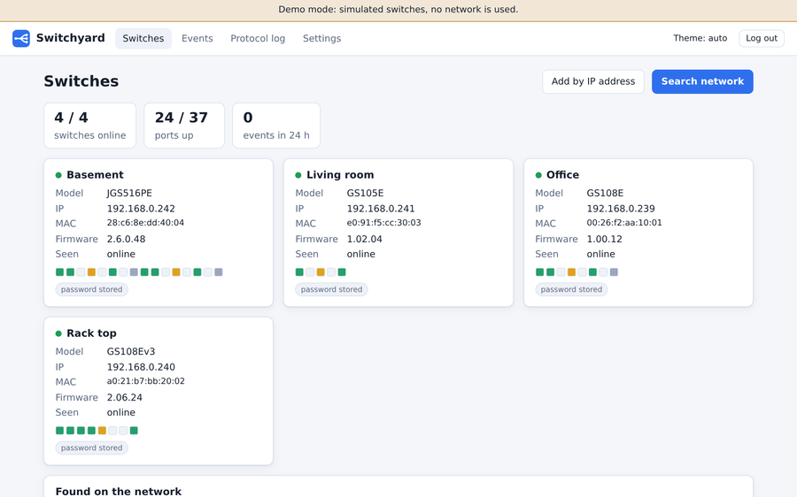
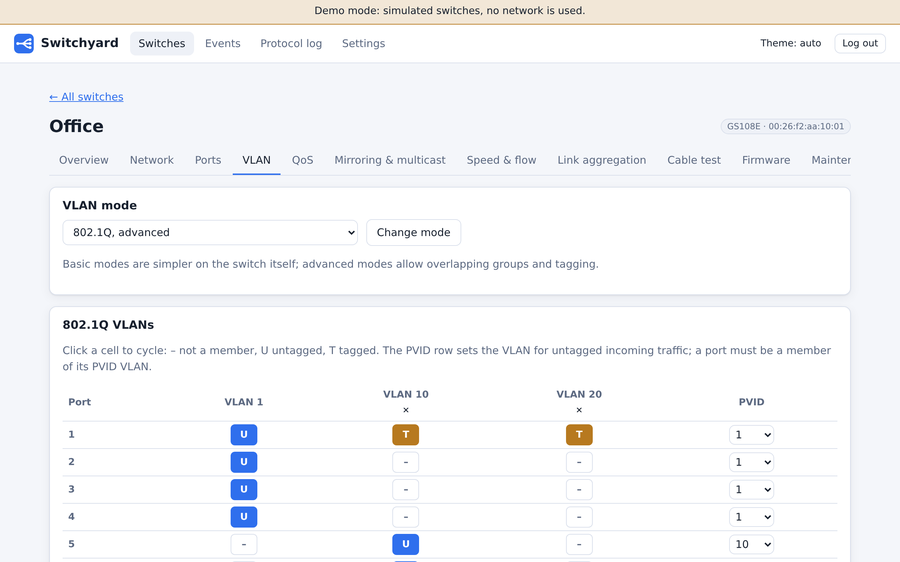
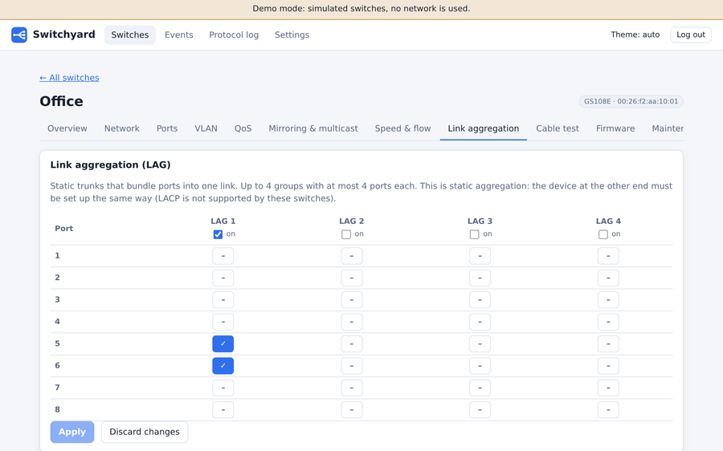
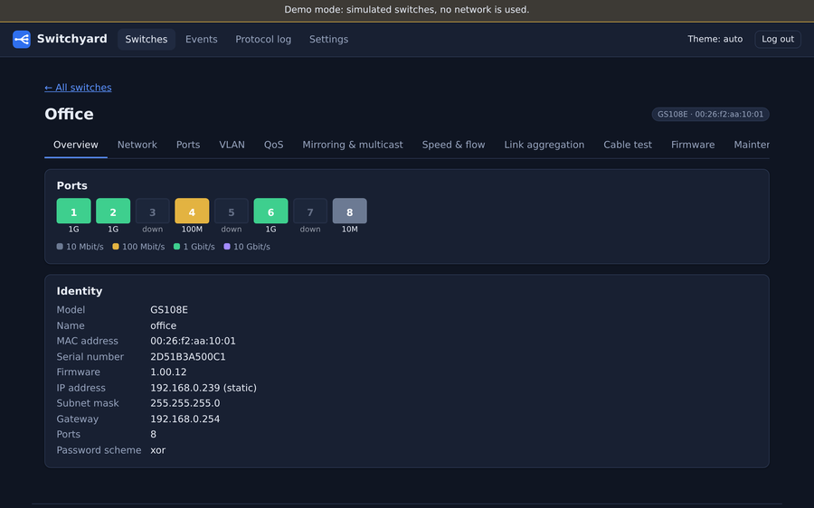
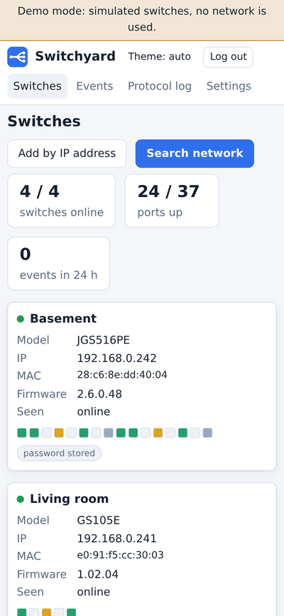
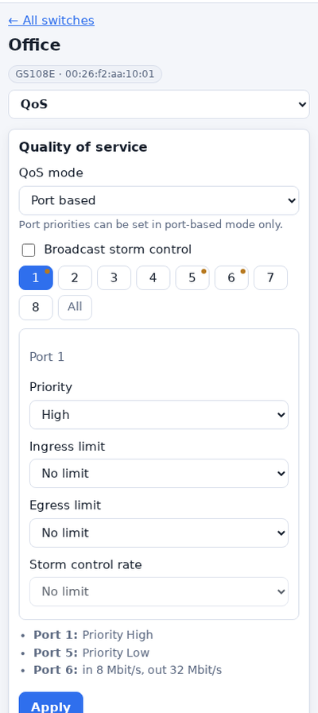

My network has a small Netgear GS108E in it, one of the first hardware revision.
It is one of those cheap "Plus" switches that can do VLANs, QoS and port mirroring without being a real managed switch.
The early versions of these switches have no web interface at all.
The only way to configure them is the ProSAFE Plus Utility, a Windows program built on Adobe AIR that Netgear stopped developing years ago.
Every VLAN change meant finding a Windows machine, installing a 2015 installer and hoping it still found the switch.
[Switchyard](https://github.com/PhilippMundhenk/switchyard) replaces that utility with a small self-hosted web interface, and this post is the tour.

## Background

The Plus Utility does not talk to the switch over HTTP.
It uses a small UDP protocol, usually called NSDP, that Netgear never documented.
A program sends a broadcast on the local network, and every Plus switch answers with its model, name and addresses.
From then on, settings are read and written as short lists of numbered values.
The switch keeps no session, so every change carries the admin password along with it.

Several people have taken that protocol apart over the years.
[ProSafeLinux](https://github.com/tabacha/ProSafeLinux) and [ngadmin](https://github.com/Alkorin/ngadmin) are command line tools, and there are exporters for Prometheus and a desktop app.
What I could not find was the thing I actually wanted.
That is a web page on my home server that finds all Plus switches, keeps them in a list and lets me change a VLAN from my phone.

## What it does

Switchyard runs as a single container next to the switches.
Its main page lists every switch it knows, with a dot per port coloured by link speed and a small summary of what is online.



A click on a switch opens its pages for ports with live traffic, name and IP settings, VLANs, QoS and rate limits.
Further pages cover port mirroring, IGMP snooping, the cable tester, and maintenance with backup, restore, reboot and factory reset.
Reading needs no password.
The first change asks for the switch password and can remember it on the server.

The part I care about most is the VLAN editor.
The utility made you change one VLAN at a time.
The switch also refuses many orders of operations, for example taking a port out of the VLAN it uses for untagged traffic.
Switchyard shows all VLANs as one matrix of ports, where a click cycles a cell between not a member, untagged and tagged.
It checks the table before anything is sent and applies the whole table in an order the switch accepts.



The features of later firmware are there as well, such as static link aggregation and port speed settings.
Firmware upgrades are possible too, with a checked image and a typed confirmation.



A background monitor reads the ports every 30 seconds.
That gives a traffic chart per port and a list of events when a link goes down or a switch stops answering.
The same data feeds a Prometheus endpoint and an optional webhook.

## Home Assistant

The monitor data also goes to Home Assistant.
Switchyard publishes every switch over MQTT with Home Assistant's discovery, so each switch shows up as a device without installing anything in Home Assistant.
Per port there is the link state, the speed, the traffic in both directions and the CRC error counter.
If you allow it, every switch also gets a restart button and an on/off switch per port.
Turning a port off at night then becomes an ordinary automation.

What these switches cannot tell over this protocol is just as interesting.
There is no temperature, no uptime, no PoE power and no MAC address table, so none of that can appear in Home Assistant either.



## Testing without a switch

I wrote most of Switchyard before connecting it to my own switch.
The tests run against a software switch that answers like a real one over real UDP sockets on the loopback interface.
It enforces the VLAN rules, refuses wrong passwords, goes silent during a reboot, and accepts a firmware upload over TFTP.
On top of that, browser tests drive the real interface in Chromium, and every Home Assistant discovery message is checked against Home Assistant's own schemas.

The real switch, a GS108E v1 with firmware 1.00.09, still found something the simulator did not know.
Firmware treats settings it does not know in different ways.
Some versions leave them out of the answer, some answer with an error, and some do not answer at all.
My GS108E does something else again and answers the whole request with an empty reply as soon as one setting is unknown to it.
Switchyard now notices an empty answer, asks for the settings one by one and remembers which ones the switch does not have.
The simulator has learned the same behaviour, so it stays fixed.

## Using it

The search for switches is a broadcast, so it only works with Switchyard in the same network segment as the switches.
In Docker that means host networking:

```yaml
services:
  switchyard:
    image: ghcr.io/philippmundhenk/switchyard:latest
    network_mode: host
    restart: unless-stopped
    volumes:
      - ./data:/data
    environment:
      SWITCHYARD_AUTH_PASSWORD: "choose-a-password"
```

The container runs as user 10001, so a bind-mounted `./data` folder has to belong to that user (`sudo chown 10001:10001 data`).
Without a password in the environment, Switchyard generates one on the first start and prints it once on the console.
A switch on another subnet can be added by its IP address instead of the search.
Without the search, host networking is not needed either.
A normal bridged container with the web port published (`ports: ["8080:8080"]` instead of `network_mode: host`) should work for switches added by IP address, as long as the switch answers to the sender rather than by broadcast.
Firmware upgrades are the exception, they are best done with host networking.



## On the phone

Most of my changes to the switch happen from the couch, so the phone layout matters.
Wide tables do not work on a phone, and a switch has a lot of per-port settings.
On a small screen the sections of a switch are a drop-down instead of tabs.
The statistics become one short row per port, with the link speed as the colour of the port number.
The VLAN editor puts the ports in rows and the VLANs in columns, which fits a phone and also scales to larger switches.

For QoS and port speed there is a row of port buttons and a single editor below it.
Tapping several ports and choosing a limit once sets it for all of them.
Ports that differ from the defaults get a small dot, and a short list underneath says what is set where.



The [README](https://github.com/PhilippMundhenk/switchyard#readme) has the options, and [HARDWARE.md](https://github.com/PhilippMundhenk/switchyard/blob/main/docs/HARDWARE.md) walks through a careful first run on a real switch.

## How it was built

Switchyard was written together with [Claude Code](https://claude.com/claude-code) over a few days, including the simulator, the tests and the documentation.
The protocol details come from the projects listed below and from the language files of the original utility, which list every setting it offers.
I tested it on my own switch, which is how the empty-reply behaviour above was found.

Switchyard is an independent project and is not affiliated with, endorsed or supported by Netgear.

## Improvements

- **More models**: Only my GS108E has been seen so far, so [hardware reports](https://github.com/PhilippMundhenk/switchyard/issues/new/choose) of other models are very welcome.
- **The risky parts**: The firmware upgrade has only run against the simulator, and my switch has no link aggregation or port speed settings to try.
- **Model-specific settings**: Port LEDs, power saving and loop prevention exist on some models, but Switchyard does not write them yet.

As always, the code is on GitHub, and improvements are welcome.

## References

- [Switchyard](https://github.com/PhilippMundhenk/switchyard): The web interface, simulator and documentation
- [ProSafeLinux](https://github.com/tabacha/ProSafeLinux): Command line client for these switches
- [ngadmin](https://github.com/Alkorin/ngadmin): C library and command line tool
- [nsdp-manager](https://github.com/assimilat/nsdp-manager): Go library with a desktop app
- [Home Assistant MQTT discovery](https://www.home-assistant.io/integrations/mqtt/#mqtt-discovery): How the switches appear in Home Assistant
