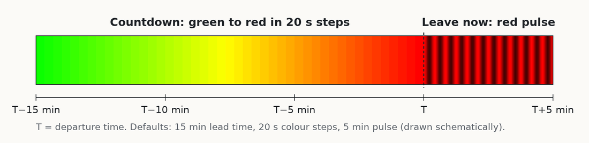
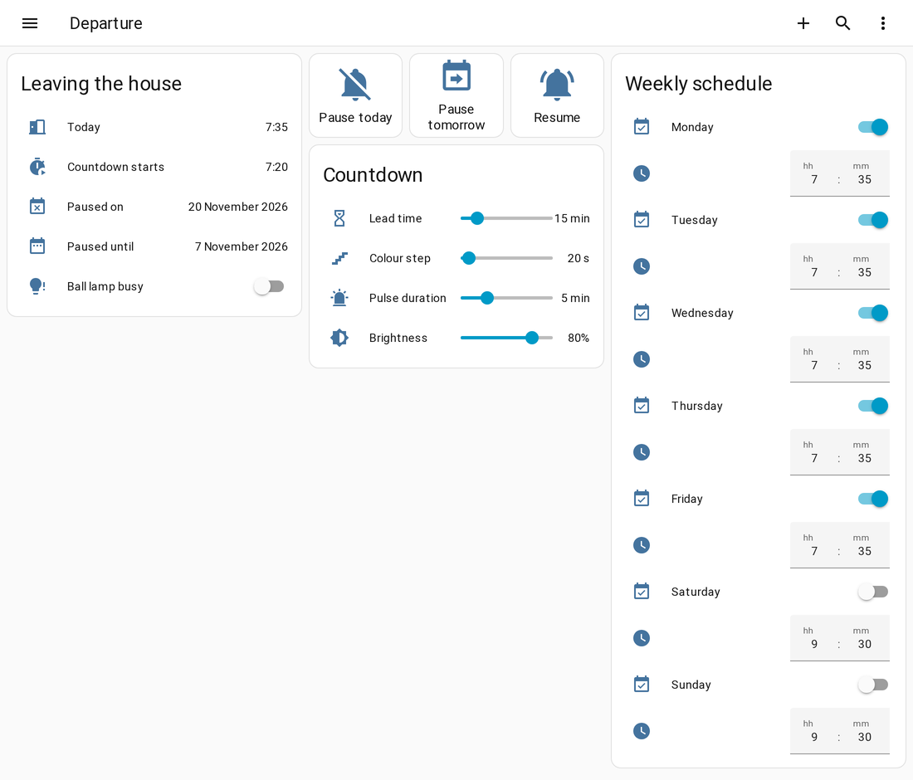

Our living room has a round IKEA Trådfri colour lamp that is hard to miss.
Most of the day it simply follows the other lamps in the room.
Their white changes with the angle of the sun, as described in my post on [calibrating the Trådfri lights](/calibrating-ikea-tradfri/).
In the morning it now has a second job: It counts down to the time we have to leave the house.
Fifteen minutes before departure it turns green, slowly walks through yellow and orange to red, and pulses red when it is time to go.
This post explains how it works and which Trådfri quirks it works around.
The full Home Assistant package is available for download.



## Background

Every family knows the morning question "how much time do we still have?".
A clock answers it, but only if someone looks at it and does the maths.
A colour does not need either.
Green means there is time for breakfast, orange means shoes, and red means out of the door.

The ball lamp was the obvious place for it.
It is visible from most of the house, and it already sits in [Home Assistant](https://www.home-assistant.io/) through Zigbee2MQTT.
The idea actually started with reminders for the waste bins.
While collecting ideas, I settled on a simple rule for the lamp.
Anything that happens more often than about once a day belongs on the phone, not on a light in the middle of the room.
The departure countdown passes that test easily, and it was the most useful idea on the list, so it was built first.

## What It Does

The package defines a departure time and an on/off switch for every weekday.
From these, a template sensor computes today's departure time, and a second one the time the countdown starts.
The defaults are a lead time of 15 minutes, a colour step every 20 seconds and a red pulse for 5 minutes after the departure time.
All of these are helpers that can be changed on the dashboard without touching YAML.

The countdown runs in three phases.
At the start of the lead time the lamp turns green.
During the lead time the hue walks from 120° (green) to 0° (red) along the edge of the colour wheel.
At the departure time the lamp pulses red between 10 % and 100 % brightness until the pulse duration is over.
Afterwards the lamp goes back to what it was doing before.

When the countdown starts late, for example after a Home Assistant restart, it does not start at green.
It computes where on the way to red it should be by now and starts there.
A trigger that fires every minute acts as a safety net for exactly this case.



## Pausing for Holidays

School holidays and days off are the hard part of any schedule.
Home Assistant has a Workday integration, and there are calendar feeds for school holidays.
Combining them with an exceptions calendar would make the countdown fully automatic.
I decided against it, because it is one more thing to maintain and one more thing that is wrong on the one day it matters.

Instead, the dashboard has three buttons and a date.
"Pause today" stops a running countdown and doubles as the dismiss button when everyone is already out of the door.
"Pause tomorrow" is for the evening before a day off.
For holidays, a "paused until" date stops the countdown up to and including that day, and it starts again on its own afterwards.
"Resume" clears both.

## Working Around the Trådfri Bulbs

The obvious implementation is a single command: Turn the lamp green, then fade to red with a transition of 15 minutes.
That does not work on Trådfri bulbs, for several reasons.

The bulb interpolates colour transitions in the CIE xy colour space.
In xy, the way from one colour to another is a straight line, and between distant hues that line runs close to the white point.
A long fade from green to red therefore passes through pale, washed-out colours instead of yellow and orange.
The package walks the hue in small steps instead, by default every 20 seconds.
Each step is short enough that the straight line stays close to the edge of the colour wheel, so the colours stay saturated.
Zigbee does not like a flood of commands either, so the step is never shorter than 10 seconds.

The bulbs also do not handle brightness and colour in the same command reliably.
The package therefore always sends them as separate commands, one second apart.

The start needs care as well.
A bulb that is switched on comes up in its last colour first, and only then fades to the new one.
That would show a short flash of whatever the lamp did before.
The package turns the lamp on at 1 % brightness, sets the colour while it is nearly dark, and only then ramps up the brightness.

Blinking was the part that took the most attempts.
Switching the lamp on and off is slow and looks broken, and the Zigbee identify effects are not meant for this.
The pulse uses only brightness commands, alternating between 10 % and 100 % with a transition of 1.5 seconds.
The next command is sent 1.6 seconds later, just after the previous fade has ended, so no command interrupts a running transition.
The result is a calm breathing instead of a stutter.
The lower end stays at 10 %, because Trådfri bulbs dim non-linearly and flicker close to zero.

## Playing Nicely With the Other Automations

The ball lamp is part of the living-room light group, and another automation sets the white of that group by the angle of the sun.
Without coordination, that automation would happily overwrite the countdown with white every few minutes.
The package therefore sets a boolean helper while the countdown runs, and the sun automation has a condition that this helper is off.
The download contains the matching version of the sun automation as an example.

The end of the countdown had a surprise.
After the pulse, the other lamps in the living room turned on, even though they had been off all morning.
The group reads "on" as soon as one of its lamps is on.
The sun automation saw a room that was on and did what it was meant to do.
The fix is to record the state of the lamp and the room before the countdown touches anything.
At the end there are three cases.
If the lamp was off, it is turned off, and the package waits until the bulb reports it as off.
If the room was on, the package runs the sun automation once itself, so all lamps get the current white.
Otherwise the lamp gets its own previous brightness and colour back, again as two separate commands.

## Installing It

The package is a single YAML file with all helpers, sensors, scripts and the automation.
Home Assistant loads it from the `packages` folder once `configuration.yaml` contains:

```yaml
homeassistant:
  packages: !include_dir_named packages
```

The files:

- [departure_ball.yaml](/files/departure-light/departure_ball.yaml): the package, to be copied to `/config/packages/`
- [departure_view.yaml](/files/departure-light/departure_view.yaml): the Departure tab for a YAML dashboard
- [sun_automation.yaml](/files/departure-light/sun_automation.yaml): an example sun automation that respects the countdown

Three entity IDs at the top of the automation need to be changed: the colour lamp, its light group and the sun automation.
New number helpers start at their minimum, so the lead time, step, pulse duration and brightness need to be set once on the dashboard.
New date helpers start at today's date, which pauses the countdown for the day of the installation.
"Resume" clears that.
The package should work with any colour lamp, but it is only tested with a Trådfri RGB bulb through Zigbee2MQTT.

## How It Was Built

The package was written together with Claude in a chat over three days.
Claude wrote the YAML, and I ran each version on the real lamp and reported what it did.
Most of the Trådfri workarounds came out of that loop: The washed-out fade, the flash of the old colour, the stuttering blink and the lamps that turned on afterwards.
The timeline picture is drawn from the package's default values.
The dashboard screenshot comes from a test instance of Home Assistant with a virtual lamp.
On that instance, a shortened countdown ran through both restore cases before publishing: The lamp off, and the lamp on in warm white.

This project is not affiliated with IKEA or Home Assistant.

## Improvements

- **Waste bins**: A reminder in the colour of the bin, based on the Waste Collection Schedule integration, is designed but not built yet.
- **Colour after turn-off**: The bulb keeps its last colour while it is off, so the next "on" from another automation can briefly show red.
- **Other notifications**: A postbox notification also flashes the lamp and could collide with a running countdown.
- **More than one departure**: The package supports one departure time per day.

As always, improvements to the package are welcome.

## References

- [Calibrating IKEA Tradfri RGBW Lights](/calibrating-ikea-tradfri/): the sun-based white this builds on
- [Home Assistant packages](https://www.home-assistant.io/docs/configuration/packages/): how packages are loaded
- [Zigbee2MQTT](https://www.zigbee2mqtt.io/): the Zigbee bridge for the bulbs
- [departure_ball.yaml](/files/departure-light/departure_ball.yaml): the full package
