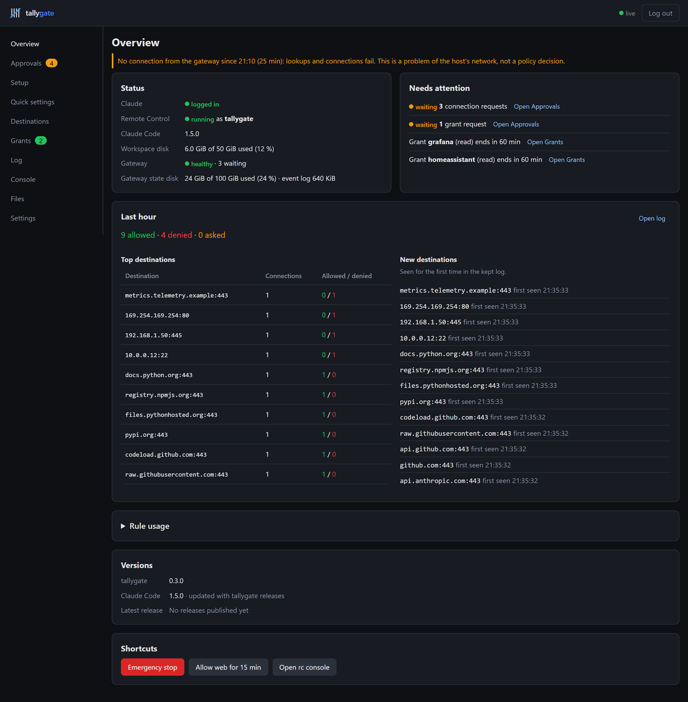
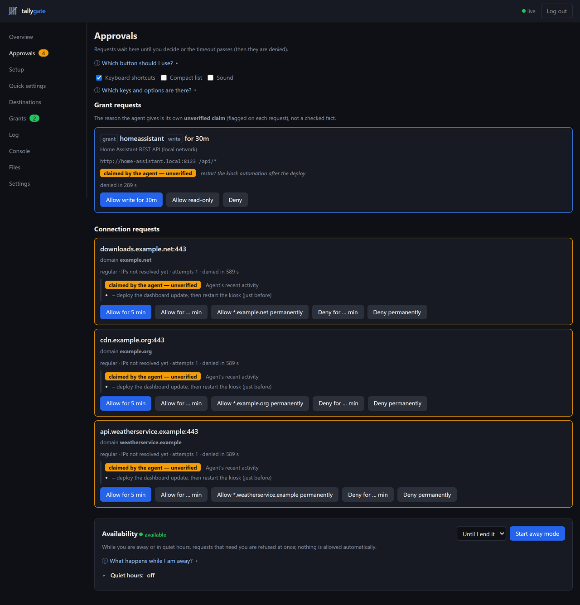
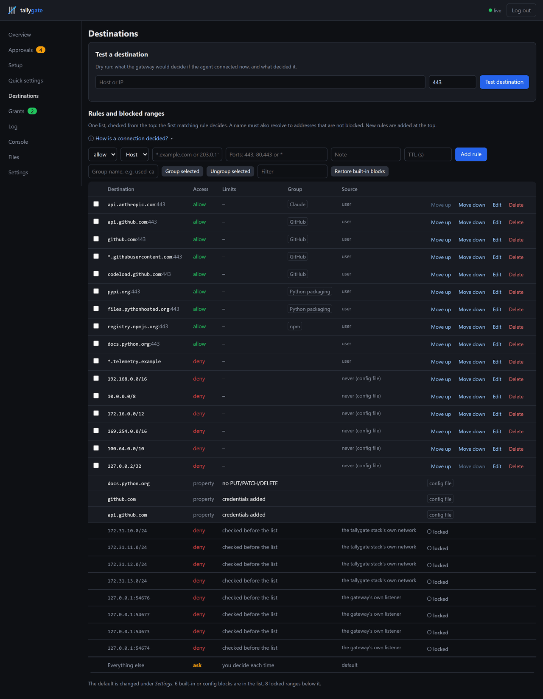

Most of the projects in the last posts were written together with Claude Code.
More and more of that work happened while I was not at the desk.
An agent that works unattended needs permission to run commands without asking.
A process with that permission and a network connection can send anything anywhere.
That includes my GitHub token, the files in its workspace and every device on my home network.
[tallygate](https://github.com/PhilippMundhenk/tallygate) is my answer to that.
It is a gateway that every connection of the agent has to pass, and I decide about the ones it does not know.
This post is the tour of what it does, why it is built this way and what the security reviews found.

## Background

Claude Code has a feature called [Remote Control](https://code.claude.com/docs/en/remote-control), which lets me talk to a session on my server from the Claude app on the phone.
That is exactly how I want to work: Describe a task on the train, look at a pull request in the evening.
For this to be useful, the agent must not ask before every command, because nobody is there to answer.

The agent's own permission prompts are therefore not the safety net.
The agent reads web pages, issue comments and package descriptions, and any of them can contain instructions written for it.
I have to assume that it can be talked into things, so the limits have to sit somewhere the agent cannot reach.

## The idea

The name comes from farming.
A tally gate is the narrow gate where animals pass one at a time.
They are counted and inspected before they are let through or sorted out.
tallygate does the same with network connections.
Every one passes singly and is checked against a list of rules.
It is then let through, turned back or held until I decide.

The setup is three containers.
The agent runs Claude Code and sits on a Docker network that has no route to anything.
The gateway is the only other machine on that network and offers a proxy, and the control plane serves the web interface I use.
The isolation comes from the network layout and not from firewall rules inside the agent's container.
A program that ignores the proxy settings simply cannot connect.

Anthropic's own [reference dev container](https://docs.anthropic.com/en/docs/claude-code/devcontainer) takes a different route, and it is the setup most people meet first.
It limits the agent with an `iptables` script inside the agent's container.
The script uses a fixed list of allowed domains and resolves it to addresses once at start.
That is simple, works per project in VS Code and is a good fit at the desk.
For an agent that runs alone, three things bothered me.
The firewall sits inside the container it is meant to restrict, and the container needs extra privileges to set it up.
A list of addresses taken at start cannot follow a service that moves, and it leaves DNS open.
A destination that is not on the list simply fails, and nobody is asked.
tallygate pays for the difference with three containers and a proxy that every tool has to use.



## Asking instead of guessing

A fixed allow list is the obvious design, and it fails on the first day.
No list I write in advance contains the documentation site the agent needs for this one task.
A list that is too wide is worthless, and one that is too narrow sends me to a config file every hour.

So the default answer for an unknown destination is neither yes nor no.
The gateway holds the connection and asks me, and the agent simply waits a moment longer for its download.
I can allow the destination for five minutes, for a time I choose or permanently, for the host or its whole domain, or deny it.
The request shows what the agent was running when it asked.
That text is clearly marked as the agent's own claim, because it comes from the side I do not trust.



The same question arrives on the phone, as a push notification with buttons or in a Telegram or Matrix chat.
When I cannot answer at all, away mode refuses new destinations at once and collects them in a digest for later.
A request that nobody answers is denied, so silence never opens anything.

Names are decided before they are looked up.
A name that is denied or still waiting never reaches a DNS server.
A DNS lookup is already a way to send data out.
The agent's own DNS answers "no such name" for everything, and the gateway resolves a name only after the rules or I allowed it.

## One list, read from the top

The rules are one ordered list, as in most firewalls.
It is read from the top, and the first matching rule decides.
A default stands at the end.
The private address ranges, loopback and the cloud metadata address are blocked by ordinary rules at the bottom of that list.
To reach one device on my network I add a rule for its address above the block, and the rest of the range stays closed.

One detail took two attempts to get right.
A rule for a name never opens a blocked range, because whoever controls DNS decides where a name points.
If an allowed public name suddenly resolves to an address in my home network, the connection is refused, and the interface says why.
The networks of tallygate itself are locked outside the list and cannot be opened by any rule.
The agent can therefore never reach the interface that controls it.



## Secrets stay outside

The agent needs GitHub, and I do not want it to hold my token.
The token lives in the gateway, which adds it to requests in flight, only for GitHub's hosts and optionally only for the repositories I list.
Inside the agent, the token is a placeholder string that is worth nothing anywhere else.

For my home network there are grants.
A grant is a named, time-limited bundle of access, such as "Home Assistant API, read-only, for 30 minutes".
The agent asks for it with a reason, and I approve, reduce it to read-only or deny.

## Getting started

Everything runs from prebuilt images with one file:

```bash
mkdir tallygate && cd tallygate
curl -fsSLO https://github.com/PhilippMundhenk/tallygate/releases/latest/download/compose.yaml
docker compose up -d
docker compose logs control | grep -A1 password
```

The last line prints the generated password for the web interface.
The interface answers on `http://127.0.0.1:8080` on the Docker host and nowhere else, because it speaks plain HTTP.
From another machine I reach it through an SSH tunnel or a reverse proxy with TLS.
A setup wizard then takes the GitHub token, logs in to Claude, sets the git identity and enables Remote Control, all without a console.
The [README](https://github.com/PhilippMundhenk/tallygate#quick-start) has the details for both.

## What the reviews found

A project whose only job is to hold a line deserves someone trying to cross it.
I had the code reviewed adversarially several times, each time by a fresh reviewer that had not written it, and each round found something real.

One example shows the kind of mistake.
An address written with a trailing dot, such as `192.168.1.1.`, was treated as a name.
The gateway asked me about it like any unknown host, and my approval would have become a rule that opened my home network.
Names that are addresses in disguise are refused now, and an approval can no longer open a blocked range.

The review of version 0.4.0 found two more serious problems, and I list them here because hiding them would defeat the purpose.
The control plane followed HTTP redirects sent by the agent, which gave the agent a way to make requests that never passed the gate.
A second request on an already open plain-HTTP connection was not checked as strictly as the first.
Both are fixed in version 0.4.1, together with the fifteen smaller findings of that review.
Every finding has a [public issue](https://github.com/PhilippMundhenk/tallygate/issues?q=is%3Aissue+label%3Asecurity) that says what was wrong, what was changed and what could not be tested.

Some of the fixes are simply stricter defaults.
The web interface listens only on the machine it runs on until I decide otherwise.
The images are scanned before they are published and signed afterwards.
The compose file of a release names exactly the images it was tested with.

The lesson I take from this is not comforting, but it is useful.
The isolation by network layout held in every review, because it does not depend on getting any code right.
Everything built on top of it had holes that tests written by its author did not find.

## How it was built

Almost all of tallygate was written by Claude Code, much of it running inside tallygate.
I described what I wanted, reviewed the interface on my phone and complained about confusing wording.
The design decisions, such as the single ordered rule list, were mine.
I would not have written the tests, the threat model or the documentation by hand, and certainly not in this time.

The agent also diagnosed its own outages.
When my server lost its network for most of a day, the remote session did not come back.
The agent found the cause and fixed it.
It was a small file that Claude Code stops trusting after four hours, and tallygate now keeps a copy.

What I did myself is the part no agent could do: I used it every day and approved or denied what it asked for.
Reading those requests is a strange and useful experience, because it shows how much traffic a normal coding task causes that nobody asked for.
The most frequent request in my log was a telemetry endpoint of a command line tool.

tallygate is an independent project with no relation to Anthropic, and the name of Claude Code only says which agent it was built around.

## Improvements

- **A real browser in the tests**: The interface is tested through its server, and nothing clicks through it in a browser yet.
- **Several agents**: Today there is one agent with one policy, and a second one needs its own rules and its own log.
- **A proper outage view**: The gateway notices when the host has no network, and the agent's own status page should say so too.
- **Other agents**: Nothing in the gateway is specific to Claude Code, but the setup wizard and the remote session are.

As always, the code is on [GitHub](https://github.com/PhilippMundhenk/tallygate), and improvements are welcome, attempts to get through the gate included.

## References

- [tallygate](https://github.com/PhilippMundhenk/tallygate): Gateway, control plane, agent image
- [Threat model](https://github.com/PhilippMundhenk/tallygate/blob/main/docs/threat-model.md): What it defends against
- [How a destination is decided](https://github.com/PhilippMundhenk/tallygate/blob/main/docs/rules.md): The rule list by example
- [Claude Code Remote Control](https://code.claude.com/docs/en/remote-control): The remote session feature
- [mitmproxy](https://mitmproxy.org/): The proxy engine underneath
